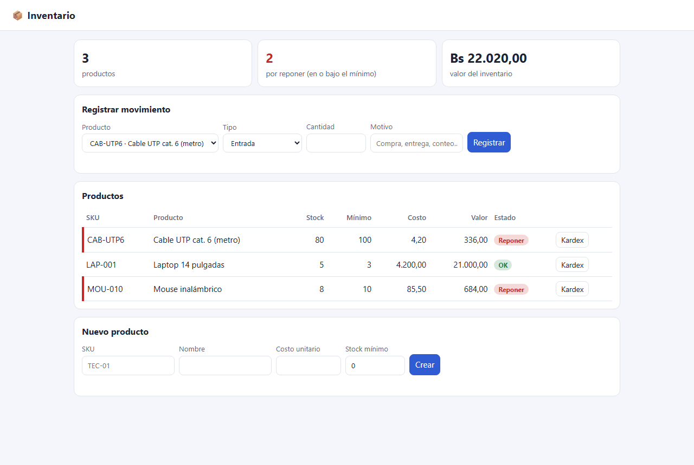

# 📦 Inventory (Spring Boot)

> 🇪🇸 [Versión en español](README.md)



REST API and web panel to manage a company's inventory: products, **stock in, stock out and physical-count adjustments**, a per-product ledger, **low-stock alerts** and inventory valuation.

## Features
- **Web panel** at `http://localhost:8080`: summary, products with reorder alerts, movement entry and ledger.
- **Products** with unique SKU, unit cost and minimum stock; search and pagination.
- **Movements:** stock in, stock out (never lets stock go negative) and adjustments that record the difference.
- **Ledger (kardex):** immutable history with the resulting stock after each movement.
- **Alerts** for products at or below minimum stock, ordered by urgency.
- **Quality:** Bean Validation, RFC 9457 `ProblemDetail` errors, optimistic locking (`@Version`) and `BigDecimal` for money.

## Stack
Java 21, Spring Boot 3 (Web, Data JPA, Validation), Hibernate, H2 in memory (or PostgreSQL), JUnit 5, AssertJ, MockMvc, Maven, Docker.

## Run it
```bash
mvn spring-boot:run        # http://localhost:8080 (loads sample products)
mvn verify                 # 11 unit and integration tests
```

## Structure
```
producto/Producto.java             entity holding the stock rules
producto/Movimiento.java           ledger entry (immutable)
producto/InventarioService.java    transactional use cases
producto/InventarioController.java REST endpoints
producto/ManejadorDeErrores.java   ProblemDetail error handling
```
Identifiers and messages are in Spanish (`producto` = product, `entradas` = stock in, `salidas` = stock out).

MIT License.
