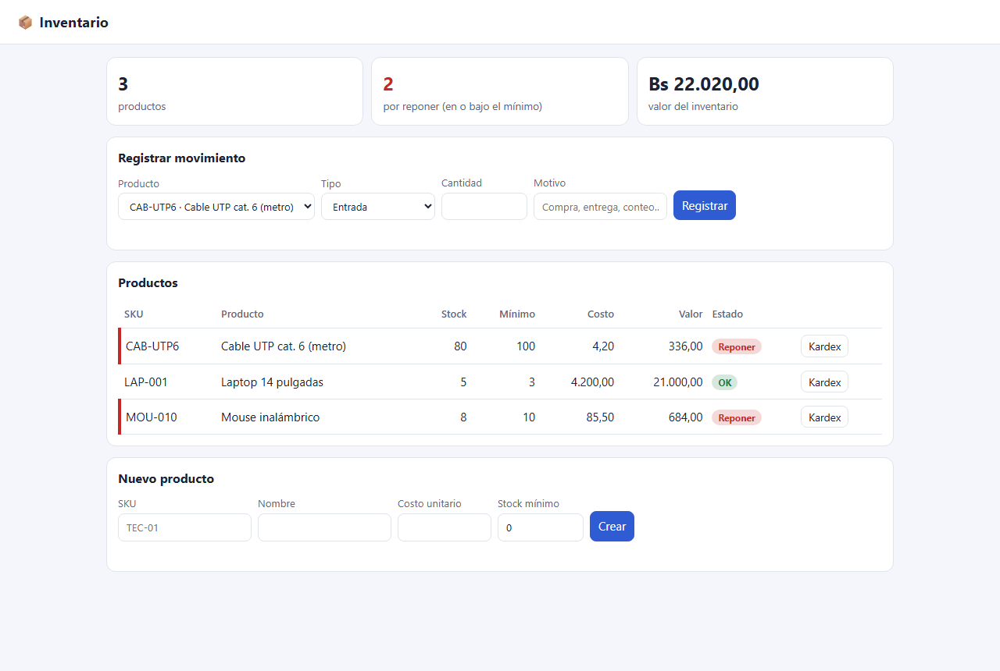

# Inventario (Spring Boot)

> [English version](README.en.md)



API REST para controlar el inventario de una empresa: productos, **entradas, salidas y ajustes por conteo físico**, kardex por producto, **alertas de stock mínimo** y valorización del inventario.

*Inventory management REST API with Java 21 and Spring Boot 3: stock movements ledger (kardex), low-stock alerts, valuation, validation, optimistic locking and RFC 9457 error responses.*

## Funciones
- **Panel web** incluido (`http://localhost:8080`): resumen, productos con alerta de reposición, registro de movimientos y kardex.
- **Productos** con SKU único, costo unitario y stock mínimo; búsqueda y paginación.
- **Movimientos**: entradas, salidas (nunca deja el stock negativo) y ajustes por conteo físico que registran la diferencia.
- **Kardex**: historial inmutable de cada producto con el stock resultante después de cada movimiento.
- **Alertas** de productos en o bajo el stock mínimo, ordenados por urgencia.
- **Resumen**: cantidad de productos, cuántos reponer y valor total del inventario.
- **Calidad**: validación de entradas (Bean Validation), errores en formato estándar `ProblemDetail`, bloqueo optimista (`@Version`) para cambios simultáneos y dinero con `BigDecimal`.

## Tecnología
Java 21, Spring Boot 3 (Web, Data JPA, Validation), Hibernate, H2 en memoria (o PostgreSQL), JUnit 5, AssertJ, MockMvc, Maven y Docker. Interfaz web en HTML, CSS y JavaScript sin frameworks.

## Cómo correrlo
```bash
mvn spring-boot:run        # http://localhost:8080 (panel web; carga productos de ejemplo)
mvn verify                 # 11 pruebas unitarias y de integración
```
Con Docker: `docker build -t inventario . && docker run -p 8080:8080 inventario`.
Para PostgreSQL: `SPRING_DATASOURCE_URL=jdbc:postgresql://host/db`, `SPRING_DATASOURCE_USERNAME`, `SPRING_DATASOURCE_PASSWORD`.

## Endpoints
| Método | Ruta | Qué hace |
|---|---|---|
| POST | `/api/productos` | Crea un producto |
| GET | `/api/productos?q=&page=&size=` | Lista y busca (paginado) |
| GET / PUT | `/api/productos/{id}` | Ver o editar |
| POST | `/api/productos/{id}/entradas` | Registra una entrada (`cantidad`, `motivo`) |
| POST | `/api/productos/{id}/salidas` | Registra una salida (valida stock) |
| POST | `/api/productos/{id}/ajustes` | Ajuste por conteo físico (`stockContado`, `motivo`) |
| GET | `/api/productos/{id}/kardex` | Historial de movimientos |
| GET | `/api/alertas/stock-minimo` | Productos que hay que reponer |
| GET | `/api/resumen` | Totales y valor del inventario |

## Estructura
```
producto/Producto.java            entidad con las reglas del stock
producto/Movimiento.java          kardex (registro inmutable)
producto/InventarioService.java   casos de uso transaccionales
producto/InventarioController.java rutas REST
producto/ManejadorDeErrores.java  errores con ProblemDetail
src/test/                         pruebas unitarias y de integración (MockMvc)
```

## Mejoras posibles
Autenticación con Spring Security, varios almacenes, órdenes de compra automáticas al llegar al mínimo y migraciones con Flyway.

---
Licencia MIT.
